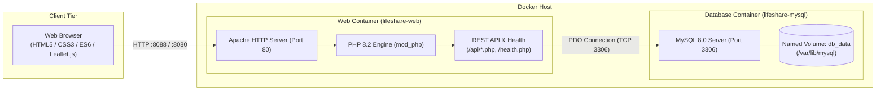

# LifeShare — GPS Blood Bank Availability Finder

LifeShare is a web-based, GPS-enabled blood bank and donor availability finder designed to bridge the gap between voluntary blood donors, hospitals, and patients during critical medical emergencies.

---

## 1. Project Overview & Problem Solved

In critical medical situations—such as urgent surgical procedures, trauma cases, or severe anemia—delays in finding compatible blood units can be life-threatening. The conventional workflow often involves making manual phone calls to dispersed blood banks, facing inaccurate inventory records, or traveling between facilities without confirmation of availability.

**LifeShare solves this problem by:**
- Aggregating real-time hospital blood stock levels and available voluntary donors into a centralized interface.
- Utilizing HTML5 Geolocation to identify the user's immediate coordinates.
- Calculating geodesic distances to every facility using the mathematical Haversine formula.
- Sorting available blood banks and donors nearest-first so emergency responders and families can reach the closest verified unit immediately.
- Providing direct emergency call buttons, WhatsApp sharing links, and turn-by-turn directions.

---

## 2. Features

- **Blood Bank & Hospital Search:** Filter registered hospitals and blood banks by specific blood groups (`A+`, `A-`, `B+`, `B-`, `AB+`, `AB-`, `O+`, `O-`) to view current unit stock.
- **GPS Location Detection:** Uses the browser's HTML5 Geolocation API (`navigator.geolocation`) to identify the user's current latitude and longitude. Also supports manual map click to drop a custom reference pin.
- **Nearest-First Proximity Sorting:** Automatically computes the spherical distance between the user's coordinates and all healthcare centers or donors, displaying matching results sorted in ascending order of distance (km).
- **Interactive Map View:** Visual map interface powered by Leaflet.js / Google Maps API displaying user location, hospital markers, donor pins, and coverage radius.
- **Voluntary Donor Network:** Platform for voluntary donors to register their contact details, blood type, and availability status.
- **Emergency Blood Requests:** Public board for patients and families to broadcast urgent blood requests categorized by severity (`Routine`, `Urgent`, `Critical`).

---

## 3. Architecture

LifeShare is structured as a two-tier containerized web application comprising a unified Apache/PHP web runtime and a dedicated MySQL relational database.



### Component Roles
1. **Browser (Client):** Executes the single-page application (SPA), renders UI components, acquires user GPS coordinates, calculates distance matrices via Haversine logic, and requests data from the backend.
2. **Web Container (`lifeshare-web`):** Built from official `php:8.2-apache`, serves static frontend assets (`index.html`, `styles.css`, `app.js`, `logo.svg`) and executes PHP API endpoints via PDO.
3. **Database Container (`lifeshare-mysql`):** Runs official `mysql:8.0`, auto-initializes relational schemas and seed data on first launch, and persists data inside a Docker named volume (`db_data`).

---

## 4. Tech Stack

| Layer | Technology | Description |
|:---|:---|:---|
| **Frontend** | HTML5, CSS3, JavaScript (ES6+) | Vanilla client-side SPA with dark/light theme support |
| **Maps & Location** | Leaflet.js / Google Maps API | Geospatial marker mapping, info windows, and route directions |
| **Geolocation** | HTML5 Geolocation API | High-accuracy coordinate detection in browser secure contexts |
| **Proximity Algorithm** | Haversine Formula | Great-circle distance calculations between spherical coordinates |
| **Backend Runtime** | PHP 8.2 (`php:8.2-apache`) | Apache mod_php web server with PDO MySQL extension |
| **Database** | MySQL 8.0 | Relational database engine with InnoDB storage and UTF-8 support |
| **Containerization** | Docker, Docker Compose | Isolated multi-container deployment with healthchecks |

---

## 5. Repository Structure

```
c:\bloodbank\
├── .github/
│   └── workflows/
│       └── ci.yml                 # GitHub Actions CI workflow definition
├── api/
│   ├── db.php                     # Shared PDO connection provider (reads DB_* env vars)
│   ├── donors.php                 # GET /api/donors.php (filtered donor listing)
│   └── hospitals.php              # GET /api/hospitals.php (hospitals and blood inventory)
├── docs/
│   ├── DEMO_SCRIPT.md             # End-to-end demonstration procedure
│   ├── DEVOPS_FINAL_REPORT.md     # Engineering report across all stages
│   ├── DEVOPS_STAGE1.md           # Stage 1 audit and containerization record
│   ├── DEVOPS_STAGE2.md           # Stage 2 CI and testing record
│   ├── DEVOPS_STAGE3.md           # Stage 3 Kubernetes, HPA, and rollback record
│   ├── PROGRESS.md                # Project milestone status tracking
│   └── stage-report.md            # Initial inventory and pre-flight audit
├── k8s/                           # Declarative Kubernetes manifests (Kustomize)
├── monitoring/                    # Observability definitions (Prometheus / Grafana)
├── tests/
│   ├── api.test.js                # API integration test suite
│   └── haversine.test.js          # Mathematical proximity unit tests
├── .dockerignore                  # Build context exclusions (keeps images lean)
├── .env.example                   # Environment variable template with safe placeholders
├── .gitignore                     # Git tracking exclusions (ignores .env and secrets)
├── app.js                         # Core client-side JavaScript logic (1 053 lines)
├── docker-compose.yml             # Local multi-service orchestration (web + mysql)
├── Dockerfile                     # Container definition for web service (php:8.2-apache)
├── health.php                     # GET /health.php (HTTP/DB healthcheck endpoint)
├── index.html                     # Main application single-page interface
├── logo.svg                       # LifeShare vector branding asset
├── package.json                   # Project scripts and test runner configuration
├── rollback.ps1                   # Automated Kubernetes deployment rollback utility
├── schema.sql                     # Relational schema DDL and Hyderabad seed dataset
└── styles.css                     # Unified application styles and UI design tokens
```

---

## 6. Prerequisites

Ensure the following tools are installed on your host system:
- **Git** (v2.x or later): To clone and manage source code.
- **Docker Desktop** (with Linux container mode active): Required to run Docker Compose and container runtimes.
- **Windows PowerShell 5.1 / PowerShell 7+** (or Bash on macOS/Linux).
- **`curl` / `curl.exe`**: For terminal-based API testing and health verification.

---

## 7. Setup & Installation

### Step 1: Clone the Repository
```powershell
git clone https://github.com/dhiraj2914/lifeshare-devops.git
cd lifeshare-devops
```

### Step 2: Configure Environment Variables
Copy the template file `.env.example` to create your local `.env` configuration:
```powershell
Copy-Item .env.example .env
```
*(On Linux/macOS: `cp .env.example .env`)*

Edit `.env` to define your local passwords and port configuration:
```env
# Host port mapping for the web app (default is 8080 or 8088 if 8080 is in use)
APP_PORT=8088

# MySQL root password (required by mysql:8.0 image)
MYSQL_ROOT_PASSWORD=your_secure_root_password_here

# Database connection credentials
DB_HOST=mysql
DB_NAME=blood_bank_db
DB_USER=lifeshare
DB_PASSWORD=your_secure_app_password_here
```
> [!CAUTION]
> Never commit `.env` to version control. It is already included in `.gitignore` to protect sensitive local secrets.

### Step 3: Build and Start Containers
Start the multi-container stack in detached mode:
```powershell
docker compose up -d --build
```

---

## 8. Accessing the Application

Once Docker indicates both containers are healthy:

| Endpoint | URL | Description |
|:---|:---|:---|
| **Web Application UI** | [http://localhost:8088](http://localhost:8088) *(or configured `APP_PORT`)* | Main user interface (GPS finder, donor search, requests) |
| **System Health Check** | [http://localhost:8088/health.php](http://localhost:8088/health.php) | JSON endpoint verifying Apache, PHP, and MySQL connectivity |
| **Hospitals API** | [http://localhost:8088/api/hospitals.php](http://localhost:8088/api/hospitals.php) | Returns all hospitals with real-time blood stock |
| **Donors API** | [http://localhost:8088/api/donors.php](http://localhost:8088/api/donors.php) | Returns registered voluntary blood donors |

### Health Check Verification
To test connectivity from the terminal:
```powershell
curl.exe --max-time 10 -s http://localhost:8088/health.php
```
**Expected Response:**
```json
{
  "status": "healthy",
  "php": "8.2.35",
  "db": "connected",
  "tables": 4,
  "ts": "2026-10-26T01:54:56+00:00"
}
```

---

## 9. Database & Seed Data

The database schema and initial data are defined in [schema.sql](file:///c:/bloodbank/schema.sql).

### Automatic Initialization
When the MySQL container runs for the first time, Docker mounts `./schema.sql` into `/docker-entrypoint-initdb.d/01_schema.sql:ro`. MySQL automatically executes this script before opening network connections.

### Relational Schema (4 Tables)
1. **`hospitals`**: Stores hospital metadata including geographic coordinates (`latitude`, `longitude`), contact phone, and address.
   - *Seeded with 6 major hospitals in Hyderabad:* NIMS (Punjagutta), Apollo Hospitals (Jubilee Hills), Care Hospitals (Banjara Hills), Yashoda Hospital (Secunderabad), Osmania General Hospital (Afzal Gunj), and Gandhi Hospital (Musheerabad).
2. **`blood_inventory`**: Tracks units available per hospital by blood group (`hospital_id` foreign key, `blood_group`, `quantity`).
   - *Seeded with 30 inventory rows.*
3. **`donors`**: Registered volunteer blood donors with phone numbers, emails, coordinates, and availability toggle.
   - *Seeded with 9 active donors.*
4. **`blood_requests`**: Patient emergency requests with urgency ratings (`Routine`, `Urgent`, `Critical`), required blood type, hospital location, and contact details.
   - *Seeded with 4 active requests.*

Data is persisted on the Docker host via the named volume `db_data` mapped to `/var/lib/mysql`.

---

## 10. Managing the Docker Stack

### Stop Services
To stop running containers without losing data:
```powershell
docker compose stop
```

### Start Services
To start existing stopped containers:
```powershell
docker compose start
```

### View Live Logs
To monitor container logs in real time:
```powershell
# Follow all container logs
docker compose logs -f

# Follow web container logs only
docker compose logs -f web

# Follow database logs only
docker compose logs -f mysql
```

### Rebuild After Code Changes
When updating frontend files or PHP scripts:
```powershell
docker compose up -d --build web
```

### Checking Container Health
```powershell
docker compose ps
```

> [!WARNING]
> **DO NOT RUN `docker compose down -v`**
> The `-v` flag deletes named Docker volumes. Executing `docker compose down -v` will **destroy the `db_data` volume**, erasing all database tables, hospital inventories, and donor records permanently. Use `docker compose down` (without `-v`) when stopping and tearing down containers.

---

## 11. Troubleshooting

### 1. Port Collision (`bind: Only one usage of each socket address is normally permitted`)
- **Cause:** Another service on your computer is already using port 8080 (such as Windows IIS, Apache, or another dev server) or port 3306 (a local MySQL instance).
- **Solution:** 
  - Change `APP_PORT` in your `.env` file to an unused port (e.g. `APP_PORT=8088`).
  - The MySQL service in `docker-compose.yml` is already mapped to host port `3307:3306` to prevent conflict with local MySQL installations on 3306.

### 2. MySQL Not Ready Yet (`HTTP 503 / "db": "unreachable"`)
- **Cause:** On initial creation, MySQL requires 15 to 30 seconds to initialize database files, apply character sets, and run the `schema.sql` seed script.
- **Solution:** The web container uses `depends_on: mysql: condition: service_healthy` to wait for MySQL readiness. If you query `/health.php` before MySQL finishes its initial boot, wait 10 seconds and test again. Inspect initialization logs using:
  ```powershell
  docker compose logs mysql
  ```

### 3. GPS Geolocation Not Working in Browser
- **Cause:** Modern browsers enforce the W3C Geolocation Secure Context specification. GPS access (`navigator.geolocation`) is only permitted on:
  - `http://localhost` (or `http://127.0.0.1`)
  - Any valid `https://` domain
- **Solution:** Access the app using `http://localhost:8088`. If accessing over a local LAN IP address (e.g., `http://192.168.1.50:8088`), the browser will automatically deny location permissions. You can also manually drop a pin on the map to set your location without GPS.

---

## 12. Planned DevOps Roadmap

The following enterprise DevOps capabilities are currently planned for upcoming implementation phases:

- **CI/CD with GitHub Actions** — *[PLANNED]*:
  - Automated PHP syntax linting (`php -l`) and JavaScript syntax verification.
  - Automated unit and integration testing (Haversine formula validation, API response verification, health probe testing).
  - Multi-stage Docker image builds tagged with commit SHAs.
  - Container vulnerability scanning using Trivy to detect and fail builds on `HIGH` or `CRITICAL` CVEs.
  - Automated container image publishing to GitHub Container Registry (`ghcr.io`) upon merges to `main`.

- **Local Kubernetes Deployment & Orchestration** — *[PLANNED]*:
  - Multi-tier declarative manifests organized with Kustomize.
  - StatefulSet with PersistentVolumeClaims (PVC) for MySQL.
  - Rolling update Deployments with readiness and liveness health probes on `/health.php`.
  - In-cluster Horizontal Pod Autoscaling (HPA) scaling between 2 and 5 replicas based on real-time CPU utilization via `metrics-server`.
  - Zero-downtime rollback capabilities to instantly revert faulty releases (`kubectl rollout undo`).

- **Monitoring, Alerting & Observability** — *[PLANNED]*:
  - Observability stack deployment using `kube-prometheus-stack` (Prometheus, Alertmanager, Grafana).
  - Alert rules covering pod restart loops, unavailable replicas, failed health checks, and sustained high CPU load.
  - Grafana dashboard visualizing live pod counts, CPU/memory consumption, and HTTP request metrics.

---

## 13. Team & Academic Context

LifeShare was conceived and developed as an academic capstone engineering project addressing healthcare resource accessibility and rapid emergency response systems.

- **Project Title:** LifeShare – GPS-Based Blood Bank Availability Finder
- **Institution:** `[University / College Name]`
- **Department:** `[Department of Computer Science & Engineering]`
- **Academic Year / Batch:** `[Academic Year / Capstone Group]`

### Project Contributors
- **Student Contributor:** `[Team Member Name 1]` — *`[Role / Responsibilities]`*
- **Student Contributor:** `[Team Member Name 2]` — *`[Role / Responsibilities]`*
- **Student Contributor:** `[Team Member Name 3]` — *`[Role / Responsibilities]`*
- **Student Contributor:** `[Team Member Name 4]` — *`[Role / Responsibilities]`*

### Academic Guide & Mentorship
- **Project Supervisor:** `[Advisor / Professor Name]`, `[Designation & Department]`
