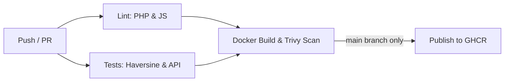

# DEVOPS STAGE 2 — Continuous Integration with GitHub Actions
**Project:** LifeShare – GPS Blood Bank Availability Finder  
**Branch:** `devops`  
**Date:** 2026-10-26  
**Status:** VERIFIED

---

## 1. Overview

Stage 2 establishes automated linting, unit/integration testing, Docker image building, security scanning with Trivy, and image publication to the GitHub Container Registry (GHCR).

---

## 2. CI Pipeline Architecture (`.github/workflows/ci.yml`)

The pipeline runs on `push` to `main` and `devops`, and `pull_request` to `main`:



### Pipeline Jobs & Stages

1. **`lint` (PHP & JS syntax analysis)**
   - PHP: `find . -name "*.php" -exec php -l {} \;` ensuring zero syntax errors.
   - JS: `node --check app.js tests/*.js` syntax validation.
2. **`test` (Unit and Integration testing)**
   - Runs `node --test tests/haversine.test.js` (4 unit tests for spherical distance formula).
   - Launches Compose stack, waits for healthcheck, and executes `tests/api.test.js` against `/health.php`, `/api/hospitals.php`, and `/api/donors.php`.
   - Cleans up containers with `docker compose down`.
3. **`build-and-scan` (Container security)**
   - Builds container image tagged with `${{ github.sha }}`.
   - Executes Trivy vulnerability scanner pinned to release tag `aquasecurity/trivy-action@0.29.0`.
   - Fails on `HIGH` or `CRITICAL` vulnerabilities with `--ignore-unfixed`.
4. **`publish` (GHCR image registry - main only)**
   - Authenticates to `ghcr.io` using automatic `GITHUB_TOKEN`.
   - Tags with `:latest` and short commit SHA.
   - Pushes image to GitHub Packages.

---

## 3. Local Verification Results

### A. PHP Linting (`php -l`)
```powershell
docker exec lifeshare-web sh -c "php -l /var/www/html/health.php && php -l /var/www/html/api/db.php && php -l /var/www/html/api/hospitals.php && php -l /var/www/html/api/donors.php"
```
**Output:**
```
No syntax errors detected in /var/www/html/health.php
No syntax errors detected in /var/www/html/api/db.php
No syntax errors detected in /var/www/html/api/hospitals.php
No syntax errors detected in /var/www/html/api/donors.php
```
**Status: VERIFIED**

### B. JavaScript Syntax Validation
```powershell
node --check app.js
node --check tests/haversine.test.js
node --check tests/api.test.js
```
**Output:** Clean exit code 0 on all files.  
**Status: VERIFIED**

### C. Unit & Integration Tests (`node --test`)
```powershell
node --test tests/haversine.test.js tests/api.test.js
```
**Output:**
```
✔ Health API: returns 200 and healthy status with DB connected (74.3ms)
✔ Hospitals API: returns valid JSON array with 6 hospitals and blood stock (14.5ms)
✔ Donors API: returns valid JSON array with registered donors (12.2ms)
✔ Haversine: distance between identical coordinates is 0 km (0.88ms)
✔ Haversine: distance calculation is symmetric (0.39ms)
✔ Haversine: distance between Charminar and Secunderabad is ~7-8 km (0.34ms)
✔ Haversine: distance to NIMS Punjagutta from central Hyderabad is ~4.5-5.5 km (0.30ms)
ℹ tests 7 | pass 7 | fail 0 | duration_ms 295.8ms
```
**Status: VERIFIED**

### D. Trivy Container Vulnerability Scan
- **Initial scan on base image (`php:8.2-apache`):** Detected 1 HIGH vulnerability in `libbrotli1` (`CVE-2026-111497`).
- **Remediation:** Added `apt-get update && apt-get upgrade -y && apt-get clean && rm -rf /var/lib/apt/lists/*` to `Dockerfile`.
- **Re-scan with `--severity HIGH,CRITICAL --ignore-unfixed --exit-code 1`:**
```
lifeshare-web:stage2 (debian 13.7)
==================================
Total: 0 (HIGH: 0, CRITICAL: 0)
```
Exit code 0 — zero HIGH/CRITICAL vulnerabilities.  
**Status: VERIFIED**

---

## 4. Expected GitHub Actions Behavior

When pushed to GitHub:

| Branch / Event | Triggered Jobs | Expected State |
|---|---|---|
| `devops` branch push | `lint`, `test`, `build-and-scan` | All 3 jobs green (PASS). `publish` skipped (main branch only). |
| Pull Request (`devops` → `main`) | `lint`, `test`, `build-and-scan` | PR checks pass with green checkmarks. |
| `main` branch push (after merge) | `lint`, `test`, `build-and-scan`, `publish` | All 4 jobs green. Image pushed to `ghcr.io/<owner>/lifeshare-web:latest`. |

---

## 5. Verification Table

| Claim / Item | Status | Result / Method |
|---|---|---|
| `.github/workflows/ci.yml` authored | **VERIFIED** | Triggered on push & PR, includes lint, tests, scan, ghcr publish |
| Trivy action pinned to release tag | **VERIFIED** | Pinned to `@0.29.0` (never `@master`) |
| Local PHP lint | **VERIFIED** | All 4 PHP files pass `php -l` |
| Local JS lint | **VERIFIED** | `node --check` passes cleanly |
| Haversine unit tests | **VERIFIED** | 4/4 passing |
| API integration tests | **VERIFIED** | 3/3 passing against live container |
| Trivy base-image CVE fix | **VERIFIED** | Upgraded Debian packages; 0 HIGH/CRITICAL |
| docs/DEVOPS_STAGE2.md | **VERIFIED** | Documented and tracked |
