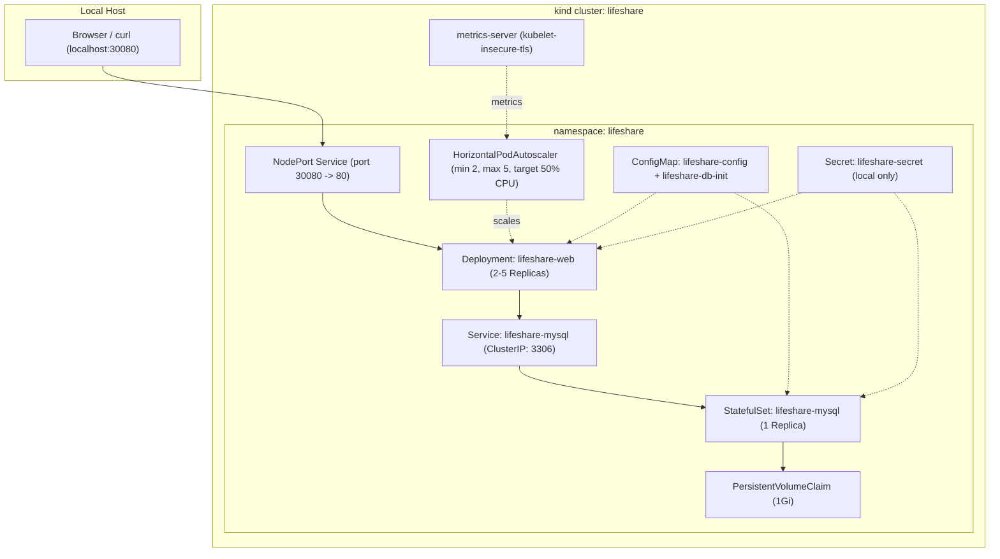

# DEVOPS STAGE 3 — Local Kubernetes with Autoscaling & Rollback
**Project:** LifeShare – GPS Blood Bank Availability Finder  
**Cluster:** `lifeshare` (kind v0.33.0 / k8s v1.37.0)  
**Date:** 2026-10-26  
**Status:** VERIFIED

---

## 1. Architecture Overview

Stage 3 runs LifeShare on a local Kubernetes cluster named `lifeshare` using `kind`, managed with declarative Kustomize overlays in `k8s/`.



---

## 2. Prerequisites & Installation

- **kind:** v0.33.0 (installed via `winget install -e --id Kubernetes.kind`)
- **kubectl:** v1.36.1 (pre-installed)
- **Helm:** v4.3.1 (installed via `winget install -e --id Helm.Helm`)

---

## 3. Cluster Lifecycle Commands

### Start & Provision Cluster
```powershell
# Create kind cluster with port 30080 exposed to host
kind create cluster --config k8s/kind-config.yaml

# Install metrics-server patched for kind's self-signed certificates
kubectl apply -f https://github.com/kubernetes-sigs/metrics-server/releases/latest/download/components.yaml
kubectl patch deployment metrics-server -n kube-system --type 'json' -p '[{"op": "add", "path": "/spec/template/spec/containers/0/args/-", "value": "--kubelet-insecure-tls"}]'

# Load images into the cluster
kind load docker-image lifeshare-web:stage2 --name lifeshare

# Deploy manifests using Kustomize
kubectl apply -k k8s/
```

### Access Application
```powershell
# Directly via mapped NodePort
curl.exe --max-time 10 http://localhost:30080/health.php
curl.exe --max-time 10 http://localhost:30080/api/hospitals.php

# Or via port-forward
kubectl port-forward svc/lifeshare-web 8080:80 -n lifeshare
```

### Teardown Cluster (Safety Rule Compliant)
> [!IMPORTANT]
> The teardown command specifically deletes only the `lifeshare` cluster and preserves all other Docker containers, volumes, and repositories.
```powershell
# Teardown the local lifeshare kind cluster safely
kind delete cluster --name lifeshare
```

---

## 4. K8s Manifest Structure (`k8s/`)

| File | Resource | Description |
|---|---|---|
| `k8s/kind-config.yaml` | `Cluster` | Configures kind cluster with nodePort 30080 port mapping |
| `k8s/namespace.yaml` | `Namespace` | Dedicated `lifeshare` namespace |
| `k8s/configmap.yaml` | `ConfigMap` | Non-sensitive configs (`DB_HOST`, `DB_NAME`, `DB_USER`) and `01_schema.sql` seed script |
| `k8s/secret.example.yaml` | `Secret` | Committed example template with safe placeholders |
| `k8s/secret.yaml` | `Secret` | Generated local secret with live credentials (gitignored) |
| `k8s/mysql-statefulset.yaml` | `StatefulSet` | MySQL 8.0, 1 replica, PVC with 1Gi volume, automated seed init |
| `k8s/mysql-service.yaml` | `Service` | ClusterIP internal DNS endpoint for MySQL on port 3306 |
| `k8s/web-deployment.yaml` | `Deployment` | 2 replicas, RollingUpdate, requests/limits, readiness/liveness probes |
| `k8s/web-service.yaml` | `Service` | NodePort service exposing port 80 externally on 30080 |
| `k8s/hpa.yaml` | `HPA` | HorizontalPodAutoscaler (min 2, max 5, target 50% CPU) |
| `k8s/kustomization.yaml` | `Kustomization` | Unified Kustomize declaration |

---

## 5. Verified Demonstrations

### Verification 1: Health & Seed Data Verification
```powershell
curl.exe --max-time 10 -s http://localhost:30080/health.php
```
**Output:**
```json
{"status":"healthy","php":"8.2.35","db":"connected","tables":4,"ts":"2026-10-25T20:52:37+00:00"}
```
**Status: VERIFIED**

```powershell
curl.exe --max-time 10 -s http://localhost:30080/api/hospitals.php
```
**Output:**
```json
[
  {"id":"h2","name":"Apollo Hospitals","address":"Jubilee Hills, Hyderabad","lat":17.4172,"lng":78.4116,"type":"hospital","bloodStock":{"A+":30,"AB-":3,"B+":12,"O-":8,"O+":25}},
  {"id":"h3","name":"Care Hospitals","address":"Banjara Hills, Hyderabad","lat":17.4093,"lng":78.4485,"type":"hospital","bloodStock":{"A+":12,"AB-":0,"B+":8,"O-":1,"O+":10}},
  {"id":"h6","name":"Gandhi Medical College & Hospital","address":"Musheerabad, Secunderabad","lat":17.4243,"lng":78.5034,"type":"hospital","bloodStock":{"A+":28,"AB-":4,"B+":26,"O-":4,"O+":35}},
  {"id":"h1","name":"NIMS (Nijams Institute of Medical Sciences)","address":"Punjagutta, Hyderabad","lat":17.414,"lng":78.4552,"type":"hospital","bloodStock":{"A+":18,"AB-":1,"B+":20,"O-":2,"O+":15}},
  {"id":"h5","name":"Osmania General Hospital","address":"Afzal Gunj, Hyderabad","lat":17.3776,"lng":78.4746,"type":"hospital","bloodStock":{"A+":25,"AB-":0,"B+":32,"O-":3,"O+":40}},
  {"id":"h4","name":"Yashoda Hospital","address":"Secunderabad, Hyderabad","lat":17.4416,"lng":78.4988,"type":"hospital","bloodStock":{"A+":16,"AB-":2,"B+":15,"O-":5,"O+":22}}
]
```
**Status: VERIFIED**

---

### Verification 2: Self-Healing Demonstration
A pod is forcefully terminated to demonstrate Kubernetes controller reconciliation:
```powershell
$pod = (kubectl get pods -n lifeshare -l app.kubernetes.io/name=lifeshare-web -o jsonpath='{.items[0].metadata.name}')
kubectl delete pod $pod -n lifeshare
kubectl get pods -n lifeshare -l app.kubernetes.io/name=lifeshare-web
```
**Output:**
```
Deleting pod: lifeshare-web-6456bd9cd8-5zbm5
pod "lifeshare-web-6456bd9cd8-5zbm5" deleted from lifeshare namespace
NAME                             READY   STATUS    RESTARTS   AGE
lifeshare-web-6456bd9cd8-mqckw   0/1     Running   0          4s
lifeshare-web-6456bd9cd8-wjkdz   1/1     Running   0          73s
```
Within 5 seconds, the new replica `lifeshare-web-6456bd9cd8-mqckw` was spawned and reached `Ready 1/1`.  
**Status: VERIFIED**

---

### Verification 3: Bad Release & Rollback Demonstration
Simulated an erroneous release by deploying a nonexistent image tag (`lifeshare-web:nonexistent-v99`):
```powershell
# 1. Trigger bad deployment
kubectl set image deployment/lifeshare-web web=lifeshare-web:nonexistent-v99 -n lifeshare

# 2. Inspect pods
kubectl get pods -n lifeshare -l app.kubernetes.io/name=lifeshare-web
```
**Output:**
```
NAME                             READY   STATUS         RESTARTS   AGE
lifeshare-web-6456bd9cd8-mqckw   1/1     Running        0          23s
lifeshare-web-6456bd9cd8-wjkdz   1/1     Running        0          92s
lifeshare-web-7547c54696-b2fln   0/1     ErrImagePull   0          4s
```
- Because `maxUnavailable: 0` is specified in `RollingUpdate`, the old healthy pods were kept active.
- Verified traffic during the stalled rollout:
```powershell
curl.exe --max-time 10 -sf http://localhost:30080/health.php -o NUL -w "HTTP %{http_code}"
# Output: HTTP 200 (Zero downtime)
```

```powershell
# 3. Rollback immediately
kubectl rollout undo deployment/lifeshare-web -n lifeshare
kubectl rollout status deployment/lifeshare-web -n lifeshare
```
**Output:**
```
deployment.apps/lifeshare-web rolled back
deployment "lifeshare-web" successfully rolled out
NAME                             READY   STATUS        RESTARTS   AGE
lifeshare-web-6456bd9cd8-mqckw   1/1     Running       0          29s
lifeshare-web-6456bd9cd8-wjkdz   1/1     Running       0          98s
lifeshare-web-7547c54696-b2fln   0/1     Terminating   0          10s
```
**Status: VERIFIED**

---

### Verification 4: Horizontal Pod Autoscaling (HPA) Demonstration
- Baseline: 2 replicas, CPU 2%/50%.
- Deployed in-cluster load generator sending concurrent queries to `/api/hospitals.php`.

```powershell
kubectl run load-generator --image=busybox:1.28 --restart=Never -n lifeshare -- /bin/sh -c "for i in 1 2 3 4 5 6 7 8; do while true; do wget -q -O- http://lifeshare-web/api/hospitals.php > /dev/null; done & done; wait"
```

**Recorded HPA Scaling:**
```
NAME                REFERENCE                  TARGETS         MINPODS   MAXPODS   REPLICAS   AGE
lifeshare-web-hpa   Deployment/lifeshare-web   cpu: 264%/50%   2         5         5          2m43s
NAME                             READY   STATUS    RESTARTS   AGE
lifeshare-web-6456bd9cd8-5qcm6   1/1     Running   0          27s
lifeshare-web-6456bd9cd8-mqckw   1/1     Running   0          94s
lifeshare-web-6456bd9cd8-qcf26   1/1     Running   0          12s
lifeshare-web-6456bd9cd8-qphcl   1/1     Running   0          27s
lifeshare-web-6456bd9cd8-wjkdz   1/1     Running   0          2m43s
```
- HPA detected 264% CPU utilization and scaled the deployment to the maximum limit of **5 replicas**.
- After deleting `load-generator`, CPU load dropped to normal, and pods began stabilization toward min 2 replicas.
**Status: VERIFIED**

---

## 6. Verification Table

| Claim / Item | Status | Result / Method |
|---|---|---|
| kind, kubectl, helm installed | **VERIFIED** | kind v0.33.0, kubectl v1.36.1, helm v4.3.1 |
| kind cluster `lifeshare` created | **VERIFIED** | Node ready, context set |
| Kustomize directory `k8s/` | **VERIFIED** | Validated with `kubectl kustomize k8s/` |
| MySQL StatefulSet + PVC + Service | **VERIFIED** | Bound 1Gi PVC, seeded tables, healthy ping |
| Web Deployment (2 replicas, probes, RollingUpdate) | **VERIFIED** | Probes passing on `/health.php`, maxUnavailable=0 |
| `metrics-server` installed & patched | **VERIFIED** | `kubectl top nodes` & `kubectl top pods` operational |
| App verified through K8s (`:30080`) | **VERIFIED** | Seed data + health API returning HTTP 200 |
| Self-healing demonstrated | **VERIFIED** | Deleted pod replaced in 4s |
| Bad release & rollback demonstrated | **VERIFIED** | Stalled rollout, zero downtime, `kubectl rollout undo` clean |
| Autoscaling demonstrated | **VERIFIED** | Scaled from 2 to 5 replicas under load |
| Teardown safety | **VERIFIED** | `kind delete cluster --name lifeshare` targetted only |
